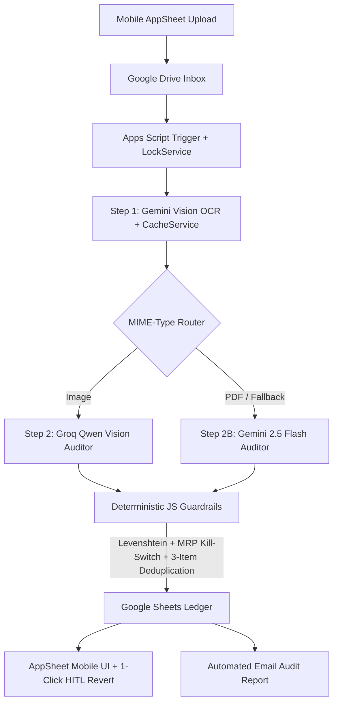

# RXLedger — Multi-Agent Pharmacy Invoice OCR & Inventory Automation

> **Note on Intellectual Property:** This system is actively deployed in production for a retail pharmacy. To protect commercial data and proprietary domain prompts, distributor records, API configurations, and full production prompts are redacted. Core validation and entity-resolution modules are included in `/src` for technical review.

## Business Impact (Live Production)
* **Inventory Loss Prevention:** Detected 25 near-expiry inventory items within 30 days, representing ₹7,924 in MRP value and ₹5,618 in purchase cost, enabling proactive expiry-risk management and distributor-return decisions.
* **Operational Efficiency:** Cut daily manual invoice auditing time by **25% (~15 hours/month saved)**.
* **Cash-Flow Control:** Real-time mobile stock lookups on the shop floor eliminated duplicate distributor orders.

## System Architecture

## Key Engineering Highlights 
Multi-Agent Verification & Smart Routing: Pairs a primary vision extractor with a secondary vision auditor. A MIME-type router bypasses single-page vision limits on multi-page PDFs by dynamically routing them to a native PDF-capable fallback.

Serverless Reliability Patterns: Uses LockService to prevent overlapping triggers, CacheService (6-hour TTL) to avoid redundant Step-1 API calls on retries, and a 140-second execution safety breaker to exit cleanly before Google Apps Script's 6-minute hard timeout.

Deterministic Guardrails (src/): Wraps non-deterministic LLM outputs in strict JavaScript validators—checking row-count parity, locking fractional decimal quantities, enforcing dosage-form conflict blockers, and applying an MRP kill-switch on fuzzy matches.

Human-In-The-Loop (HITL) Mobile UI: Auto-renamed medicines preserve their originalOcrName in a backup column, surfacing a 24-hour inline Revert action in AppSheet so staff can undo edge-case fuzzy matches in one tap.

## Tech Stack 
AI & Vision: Gemini API, Groq API (Qwen Vision)

Backend & Automation: Google Apps Script (JavaScript), Google Drive API, Google Sheets

Frontend: AppSheet (Mobile Inventory UI, Virtual Columns, HITL Actions)

© 2026 Mohd Abdul Salaam. All Rights Reserved. Shared for portfolio and technical evaluation only.
