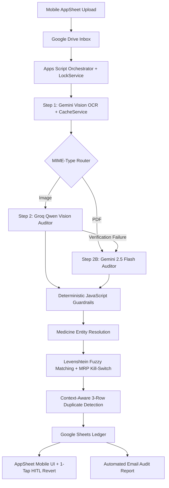

# RXLedger — Multi-Agent Pharmacy Invoice OCR & Inventory Automation

> **Note on Intellectual Property:** This system is actively deployed in production for a retail pharmacy. To protect commercial data and proprietary domain prompts, distributor records, API configurations, and full production prompts are redacted. Core validation and entity-resolution modules are included in `/src` for technical review.

## Live Production Walkthrough (6:07)

[](https://youtu.be/bXlqRgH4Zsw)

**[Watch the 6-Minute Production Walkthrough on YouTube →](https://youtu.be/bXlqRgH4Zsw)**


## Business Impact (Live Production)
* **Inventory Loss Prevention:** Detected 25 near-expiry inventory items within 30 days, representing ₹7,924 in MRP value and ₹5,618 in purchase cost, enabling proactive expiry-risk management and distributor-return decisions.
* **Operational Efficiency:** Cut daily manual invoice auditing time by **25% (~15 hours/month saved)**.
* **Cash-Flow Control:** Real-time mobile stock and purchase-history lookups help pharmacy staff check existing inventory before placing distributor orders, reducing the risk of duplicate purchases.

## System Architecture


## Repository Structure

```text
RXLedger/
├── README.md
├── .gitignore
├── src/
│   ├── pipeline_skeleton.js
│   ├── fuzzy_matcher.js
│   └── output_validator.js
└── assets/
    ├── appsheet-mobile-ui.png
    └── email-audit-log.png
```

## Key Engineering Highlights

### 1. Sequential Multi-Agent Invoice Intelligence

Designed a two-stage AI verification pipeline:

- **Agent 1 — Extraction:** Gemini processes invoice images and complete multi-page PDFs, extracting distributor details and medicine-level purchase records.
- **Agent 2 — Verification:** Groq Qwen Vision independently audits image-based extractions, while Gemini 2.5 Flash handles PDF verification and acts as the fallback when image verification fails.

The pipeline uses file-type-aware routing to select the appropriate verification path.

### 2. Multi-Page PDF Processing

Processes original PDF documents rather than relying on first-page thumbnails. Both the extraction and Gemini PDF verification stages receive the original document, allowing the verifier to inspect information across multiple pages.

### 3. Deterministic Validation and Data Integrity

Built JavaScript guardrails around probabilistic AI outputs, including:

- Invoice-count and line-item-count consistency checks.
- Medicine-name locking to preserve the original extraction when the verifier attempts incorrect rewrites.
- Decimal quantity and free-quantity preservation.
- Numeric, packing, MRP, and rate validation.
- Dosage-form conflict checks and MRP-constrained fuzzy medicine matching.
- Support for negative quantities representing distributor returns.


### 4. Context-Aware Duplicate Invoice Detection

Implemented a selective three-row sampling strategy to detect potential duplicate invoices while reducing false positives caused by OCR-generated medicine-name hallucinations.

The detection logic combines invoice number, medicine name, batch, invoice date, and distributor information through multiple matching conditions rather than relying on invoice-number equality alone.

This is a deliberate performance and reliability trade-off designed for noisy, real-world pharmacy invoices.


### 5. Serverless Reliability and Recovery

- LockService prevents overlapping invoice-processing executions.
- CacheService retains successful extraction results for six hours, avoiding unnecessary repeat extraction during retries.
- Retry handling and failure-strike tracking manage temporary API failures.
- A processing safety breaker leaves an execution-time buffer before the Apps Script limit.
- Failed invoices remain available for retry and are quarantined after repeated failures.

### 6. Human-in-the-Loop Inventory Correction

Integrated a one-tap, 24-hour medicine-name revert action into the AppSheet interface. Original OCR names are preserved so pharmacy staff can reverse incorrect automated medicine-name corrections without manually reconstructing the original entry.

## Tech Stack 
AI & Vision: Gemini API, Groq API (Qwen Vision)

Backend & Automation: Google Apps Script (JavaScript), Google Drive API, Google Sheets

Frontend: AppSheet (Mobile Inventory UI, Virtual Columns, HITL Actions)

© 2026 Mohd Abdul Salaam. All Rights Reserved. Shared for portfolio and technical evaluation only.
